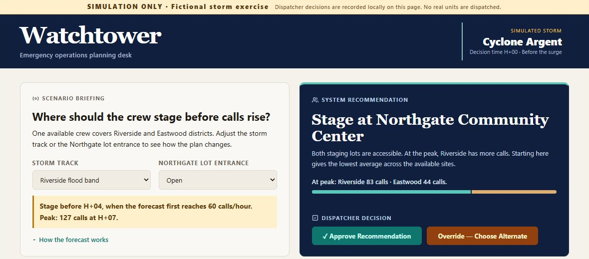

# Watchtower

**Sheriff Rijas and Piya Jaiswal** · IBM SkillsBuild AI Experiential Learning Lab · Government & Public Services

Where should a crew wait **before** emergency calls rise? Watchtower lets a dispatcher explore that question during the fictional Cyclone Argent. All signals, locations, incidents, and travel times are synthetic. Decisions stay in the browser. There is no connection to emergency services.

## Run the demo

Download or extract the repository, then open the root `index.html` in Chrome. The app uses inline HTML, CSS, JavaScript, and SVG. No server, package installation, account, or internet connection is required.

1. Start at H+00 with the Riverside flood band and Northgate open. The warning calls for staging before H+04. Peak demand at H+07 is 83 Riverside calls and 44 Eastwood calls.
2. Inspect the comparison. Northgate is closer to Riverside but farther from Eastwood. The expected mix favors Northgate.
3. Change the storm track to Eastwood to move the preferred site to Eastwood High School. Return to Riverside and close the Northgate lot. The preferred site changes while call counts stay fixed.
4. Reopen the lot and approve Northgate. Open Override, choose Home base, enter a reason, and confirm. Both decisions appear in the log, newest first. Refresh to reset.

## Forecast and staging method

For each district and hour, forecast calls equal baseline calls plus the rounded product of the storm curve and track-specific excess calls. Baselines are 8 for Riverside and 6 for Eastwood. The twelve curve values are 0, .07, .24, .48, .66, .87, 1, .92, .80, .65, .43, and .27. Peak excess calls are 75 and 38 for the flood band, or 24 and 65 for the wind band. The first combined hour at or above 60 triggers the staging deadline. These constants were chosen for the exercise.

At peak hour, the app evaluates home base and each accessible staging site. Northgate drops out when its lot entrance closes. For each starting point, mean response time equals two minutes of turnout plus the sum of district drive times weighted by their share of the same peak-hour incidents. The accessible location with the lowest mean wins.

| Starting point | Riverside drive | Eastwood drive |
|---|---:|---:|
| Home base | 16 min | 14 min |
| Northgate Community Center | 6 min | 16 min |
| Eastwood High School | 13 min | 6 min |

The two comparison runs differ only in the crew's starting location. For the default 83/44 split, base averages 17.3 minutes and Northgate averages 11.5. The simulated difference of 5.8 minutes is calculated before rounding. The comparison evaluates the system recommendation. A dispatcher override records a separate judgment.

Expand the hourly district breakdown beneath the chart to inspect all twelve hours. A follow-up IBM Bob Agent request implemented this table and its peak-hour marker. The chart and table use the same calculated forecast. The demand sensitivity slider separately explores how much the peak split can shift before another site wins. In the open-lot Riverside scenario, moving nine of 127 calls from Riverside to Eastwood changes the fastest site.

## Scope and limitations

This deterministic training model covers two districts. It uses assumed drive times and independently replays each incident with one crew ready. It omits queues, service duration, staging travel, simultaneous demand, and forecast uncertainty. The numbers demonstrate the method and carry no claim of real-world accuracy or response-time savings. Each log entry captures the decision, timestamp, site, reason and scenario. The log clears on reload.

## IBM Bob and development evidence

One IBM Bob Agent request produced the original working HTML dashboard, fictional storm, preset forecast, chart, Northgate recommendation, decision controls and log. The preserved original file is in `evidence/bob-baseline.html`. Its SHA-256 is `c02da0504882d7e8bc7a39ff59d9aabd15bdcfeb55cc121d95614d0e5f0ce1ec`. See `evidence/ibm-bob-task.png` for the completed task in Bob.

Bob also implemented the hourly district table and redesigned the dashboard so the dispatcher can see the warning, recommendation and controls together. The final presentation adds a district-share bar, an explicit threshold on the chart and responsive styling.

The subsequent local edits added district calculations, route-aware ranking, the paired comparison, and scenario context in the log. The app runs plain JavaScript at runtime. The team did not integrate watsonx Orchestrate or an inference service.

## Verification

The final local file was opened in desktop Chrome. At a 1200 by 680 viewport, both decision buttons fit on the first screen. At 390 pixels wide, the page fits horizontally and the cards stack. The 12-hour chart and persistent simulation label rendered. The Riverside and Eastwood tracks produced peaks of 127 and 103 respectively at H+07. Closing Northgate on the Riverside track switched staging to Eastwood while preserving the 127-call peak. Reopening restored Northgate. Approval and a valid Home base override produced separate visible timestamped entries. Incomplete overrides did not add entries.

Run `node tests/check.cjs` from the repository root to repeat the offline logic checks if Node.js is available. The checks exercise the embedded script using a small DOM test double. They verify 12 bars, both required fields, both decisions, all four track/access combinations and their comparison means. Node.js is only needed for this optional test.

